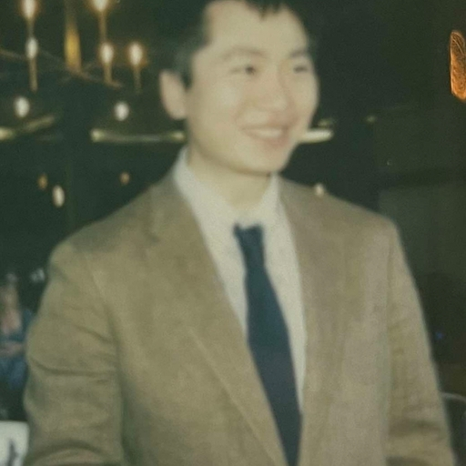

## About

I'm Andy, a fourth year PhD student (started Fall 2023) in the School of Computer Science at the University of Illinois Urbana-Champaign. I am advised by [Hari Sundaram](https://sundaram.cs.illinois.edu/) in the [Crowd Dynamics Lab](https://crowddynamicslab.github.io/). Broadly, I am interested in algorithmic game theory, mechanism design, optimization, and behaviorally informed learning. I am particularly interested in algorithms and mechanisms for managing agents with scarce attention and uncertain preferences.

In my free time I enjoy racquet sports, cooking, and watching movies. I also help organize the Champaign-Urbana coffee club, please let me know if you are interested in joining. You may find some of my work, contact information, and a picture of my face below.

### Work

My resume is [available here](/ResearchResumeAUG26.pdf).

1. Lee, Andy, and Hari Sundaram. "Auctioning Attention on Social Networks." arXiv preprint arXiv:2608.06665 (2026).
   - _An auction based method for eliciting content producers' values over the content they create; balances between the welfare of multiple stakeholders_
2. Balepur, Naina, Andy Lee, and Hari Sundaram. "Friends with Costs and Benefits: Community Formation with Myopic, Boundedly-Rational Actors." arXiv preprint arXiv:2312.14293 (2023).
   - _Modeling resource constrained, boundedly rational agents in network formation, currently being expanded for resubmission_ 
3. Lee, Andy C.. "Analysis of Covariance Intersection For Triangulation." , Aug. 2024. https://doi.org/10.2172/2429882
   - _Covariance intersection based methods for object tracking_
4. Dean, Abdullah, et al. "Firefighting on the hexagonal grid." Discrete Applied Mathematics 305 (2021): 16-22.
   - _Bounding spread in infinite planar graphs_

### Teaching

* TA CS173 Discrete Structures
* TA CS105 Intro CS for non-technical majors
* TA CS225 Data Structures and Algorithms

### Face

### Awards

* Outstanding TA Spring 2025
* Wing Kai Cheng fellowship 2023-2024
* Illinois Geometry Lab Research Award 2021

###### Contact information

You may reach me at andy2\[AT]illinois.edu.

You may find my [LinkedIn](https://www.linkedin.com/in/anandyclee/) and my [Github](https://github.com/andyclee) pages as well.
